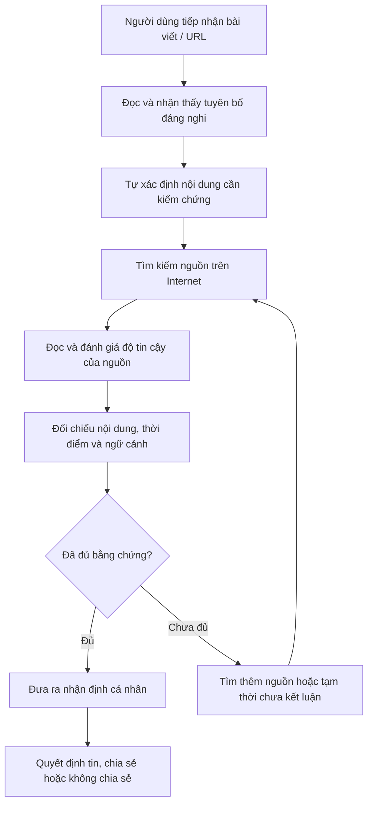
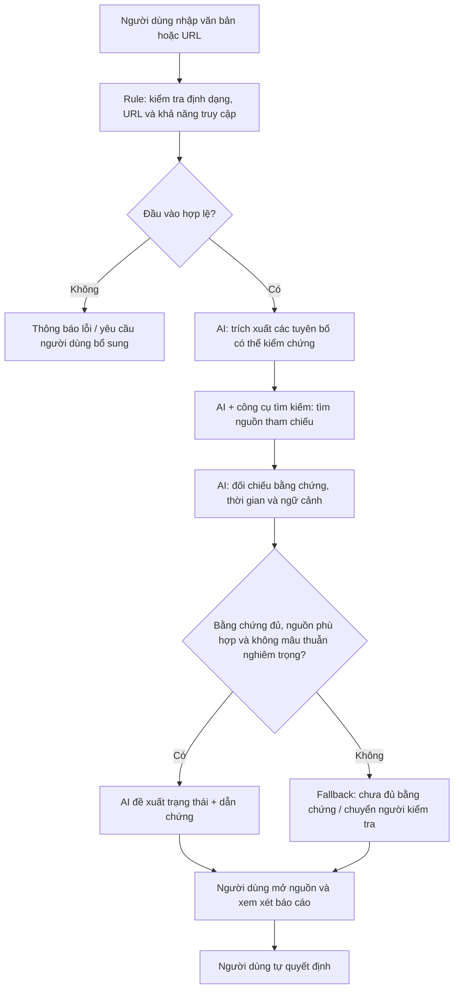

# CP5 — QUY TRÌNH & PROBLEM STATEMENT V0
## Đề tài: Kiểm chứng độ chính xác thông tin trên không gian mạng (FactCheck AI)

> **Phạm vi bản dự thảo:** Nội dung này được xây dựng từ problem đã lựa chọn trong báo cáo cá nhân: người dùng gặp khó khăn khi tìm kiếm, đánh giá và đối chiếu nguồn tham chiếu để kiểm chứng thông tin trực tuyến. Đây là bản v0 phục vụ thảo luận nhóm. Thời gian xử lý, tần suất gặp vấn đề và mức độ tác động chưa được đo bằng quan sát/phỏng vấn thực tế, vì vậy không tự điền số liệu giả định.

---

# MỤC 4. PROCESS MAPPING — QUY TRÌNH HIỆN TẠI VÀ QUY TRÌNH TƯƠNG LAI

## 4.1. Xác định phạm vi quy trình

**Tình huống được chọn:** Một người dùng tiếp nhận một bài viết hoặc đường dẫn có chứa một tuyên bố đáng nghi và muốn kiểm tra xem tuyên bố đó có căn cứ hay không trước khi tin tưởng hoặc chia sẻ.

**Actor chính:** Người dùng Internet/người tiếp nhận thông tin.

**Actor hỗ trợ trong quy trình tương lai:** Hệ thống Rule, thành phần AI hỗ trợ tìm kiếm và tổng hợp bằng chứng, người kiểm tra kết quả trong các trường hợp cần đánh giá chuyên môn hoặc có rủi ro cao.

**Phạm vi MVP đề xuất:** Ưu tiên kiểm chứng các tuyên bố dạng văn bản trong nội dung hoặc URL. Kiểm chứng nguồn gốc ảnh/video và phát hiện nội dung bị chỉnh sửa là phạm vi mở rộng, chưa mặc định nằm trong MVP đầu tiên.

## 4.2. Quy trình hiện tại — As-Is

### 4.2.1. Mô tả các bước

| Bước | Actor | Input | Hoạt động hiện tại | Output | Thời gian |
|---|---|---|---|---|---|
| 1. Tiếp nhận | Người dùng | Bài đăng, tin tức, URL hoặc nội dung được chia sẻ | Đọc nội dung và nhận thấy một tuyên bố cần kiểm tra | Tuyên bố/nội dung đáng nghi | Chưa đo |
| 2. Xác định điều cần kiểm chứng | Người dùng | Nội dung ban đầu | Tự xác định câu nói, số liệu hoặc sự kiện cần xác minh | Tuyên bố cần kiểm chứng | Chưa đo |
| 3. Tìm kiếm nguồn | Người dùng | Từ khóa, tên riêng, sự kiện, số liệu | Tìm kiếm trên công cụ tìm kiếm, báo chí hoặc website liên quan | Danh sách kết quả/nguồn tham khảo | Chưa đo |
| 4. Đọc và đánh giá nguồn | Người dùng | Các kết quả tìm kiếm | Xem tác giả, đơn vị xuất bản, ngày đăng, nguồn trích dẫn và mức độ liên quan | Các nguồn được chọn hoặc loại bỏ | Chưa đo |
| 5. Đối chiếu bằng chứng | Người dùng | Tuyên bố và các nguồn đã chọn | So sánh nội dung, thời điểm, ngữ cảnh; tìm điểm đồng thuận hoặc mâu thuẫn | Nhận định tạm thời về bằng chứng | Chưa đo |
| 6. Kết luận và quyết định | Người dùng | Nhận định và bằng chứng đã tìm được | Quyết định tin, không tin, tìm thêm hoặc không chia sẻ | Kết luận cá nhân và hành động tiếp theo | Chưa đo |

**Tổng thời gian:** Chưa có baseline. Cần đo trực tiếp trên một tác vụ kiểm chứng thực tế; không cộng hoặc ước lượng thời gian khi chưa có quan sát.

### 4.2.2. Sơ đồ As-Is

### 4.2.3. Bottleneck và cách xác minh

**Bottleneck giả thuyết:** Bước 3–5, tức tìm kiếm, đánh giá và đối chiếu nhiều nguồn. Người dùng có thể tìm thấy nhiều kết quả nhưng vẫn khó xác định nguồn nào đáng tin, nguồn nào là nguồn gốc, các nguồn có độc lập với nhau hay chỉ dẫn lại cùng một thông tin, và thông tin có còn đúng trong bối cảnh hiện tại hay không.

**Trạng thái:** Đây mới là giả thuyết, chưa phải kết quả quan sát.

**Cách đo trong buổi research:**

1. Chọn một tuyên bố công khai, có thể kiểm chứng và không quá nhạy cảm.
2. Yêu cầu người tham gia tự kiểm chứng bằng cách họ thường dùng.
3. Ghi thời gian bắt đầu/kết thúc của từng bước.
4. Ghi số lượng kết quả và số nguồn thực sự được mở/đọc.
5. Ghi nhận lúc người tham gia gặp khó khăn, đổi truy vấn hoặc không biết có thể tin nguồn nào.
6. Ghi kết quả cuối cùng và các nguồn người tham gia dùng làm căn cứ.
7. So sánh với một bộ bằng chứng tham chiếu được nhóm chuẩn bị và kiểm tra trước.

**Dữ liệu cần thu thập:** thời gian tổng thể; thời gian từng bước; số nguồn mở; số nguồn được xem là đủ tin cậy; tỷ lệ tuyên bố được kết luận có căn cứ; số trường hợp người dùng phải dừng vì thiếu bằng chứng.

## 4.3. Quy trình tương lai — To-Be

### 4.3.1. Nguyên tắc thiết kế

Quy trình tương lai không giao toàn bộ quyền kết luận cho AI. Hệ thống chỉ hỗ trợ các công đoạn có thể tự động hóa, cung cấp bằng chứng và chỉ rõ giới hạn. Người dùng vẫn là người xem xét kết quả; các trường hợp rủi ro cao, bằng chứng mâu thuẫn hoặc không đủ dữ liệu phải được chuyển cho người kiểm tra hoặc trả về trạng thái chưa đủ bằng chứng.

### 4.3.2. Các bước To-Be

| Bước | Actor | Input | Xử lý | Output | Boundary / kiểm soát |
|---|---|---|---|---|---|
| 1. Gửi nội dung | Người dùng | Văn bản hoặc URL | Nhập nội dung cần kiểm chứng và xác nhận phạm vi | Yêu cầu kiểm chứng | Không yêu cầu người dùng cung cấp dữ liệu cá nhân không cần thiết |
| 2. Kiểm tra đầu vào | Rule | URL, định dạng, nội dung đầu vào | Kiểm tra URL có hợp lệ không, nội dung có thể truy cập/trích xuất không, có đủ dữ liệu để xử lý không | Đầu vào hợp lệ hoặc thông báo lỗi | Rule không kết luận nội dung đúng/sai |
| 3. Trích xuất tuyên bố | AI | Nội dung đã trích xuất | Tách các câu/tuyên bố có thể kiểm chứng; giữ nguyên ngữ cảnh và chỉ ra phần mơ hồ | Danh sách tuyên bố cần kiểm tra | Không tự bổ sung dữ kiện không có trong nội dung |
| 4. Tìm nguồn tham chiếu | AI kết hợp công cụ tìm kiếm | Tuyên bố, từ khóa, thực thể, thời điểm | Tìm nguồn sơ cấp/nguồn chính thức và các nguồn độc lập phù hợp | Danh sách nguồn và đoạn bằng chứng | Không bịa nguồn hoặc trích dẫn; nguồn không truy cập được phải ghi rõ |
| 5. Đánh giá và đối chiếu | AI hỗ trợ, người kiểm tra khi cần | Tuyên bố và bằng chứng | So sánh nội dung, thời gian, bối cảnh; phát hiện đồng thuận, mâu thuẫn và khoảng trống | Bảng bằng chứng ủng hộ/phản bác/chưa rõ | Không xem nhiều bài dẫn lại cùng một nguồn là nhiều bằng chứng độc lập |
| 6. Phân loại kết quả | AI đề xuất; người kiểm tra với trường hợp cần thiết | Bảng bằng chứng | Đề xuất trạng thái và giải thích căn cứ | Có bằng chứng ủng hộ / có bằng chứng bác bỏ / thiếu ngữ cảnh / chưa đủ bằng chứng | Không ép mọi trường hợp vào nhãn đúng hoặc sai |
| 7. Người dùng xem xét | Người dùng | Báo cáo, trích dẫn, giới hạn | Mở nguồn, xem bằng chứng và quyết định cách sử dụng thông tin | Quyết định của người dùng | AI không tự đăng, chia sẻ hoặc đưa ra quyết định thay người dùng |

### 4.3.3. Sơ đồ To-Be

## 4.4. Boundary và Fallback

### 4.4.1. Boundary — Ranh giới trách nhiệm

**Rule được phép:**
- Kiểm tra định dạng URL, trường dữ liệu bắt buộc và khả năng truy cập.
- Kiểm tra sự hiện diện của ngày đăng, tác giả hoặc liên kết nguồn nếu dữ liệu có sẵn.
- Cảnh báo khi thiếu dữ liệu đầu vào.

**AI được phép:**
- Tách và diễn đạt lại tuyên bố cần kiểm chứng nhưng phải giữ nguyên ý nghĩa.
- Đề xuất từ khóa và truy vấn tìm kiếm.
- Tóm tắt các nguồn đã truy xuất.
- So sánh bằng chứng, chỉ ra điểm ủng hộ, phản bác hoặc chưa rõ.
- Đề xuất trạng thái kèm lý do và liên kết nguồn có thể kiểm tra.

**AI không được phép:**
- Tự tạo nguồn, đường dẫn, số liệu hoặc trích dẫn.
- Khẳng định một thông tin là đúng chỉ vì nhiều website đăng lại cùng một nội dung.
- Đưa ra kết luận chắc chắn khi nguồn không đủ, lỗi thời hoặc mâu thuẫn.
- Tự suy diễn nguồn gốc ảnh/video khi chưa có bằng chứng.
- Tự động đăng bài, gắn nhãn công khai hoặc chia sẻ kết luận thay người dùng.
- Thay thế đánh giá chuyên môn trong các lĩnh vực có rủi ro cao.

**Con người chịu trách nhiệm:**
- Xem xét các trường hợp nhạy cảm, hậu quả lớn hoặc có bằng chứng mâu thuẫn.
- Kiểm tra lại nguồn và ngữ cảnh trước khi đưa ra quyết định quan trọng.
- Quyết định cuối cùng về việc tin tưởng, sử dụng hoặc chia sẻ thông tin.

### 4.4.2. Fallback — Cách xử lý khi hệ thống không thể kết luận

| Tình huống | Fallback |
|---|---|
| URL không truy cập được hoặc nội dung bị chặn | Thông báo giới hạn; yêu cầu người dùng dán nội dung hoặc cung cấp nguồn khác |
| Không tìm thấy nguồn phù hợp | Trả về “Chưa đủ bằng chứng”; không tự suy đoán |
| Các nguồn đáng tin cậy mâu thuẫn | Hiển thị các quan điểm và bằng chứng khác nhau; chuyển người kiểm tra nếu cần |
| Nguồn quá cũ hoặc không rõ thời điểm | Cảnh báo về thời gian; yêu cầu kiểm tra nguồn cập nhật |
| Tuyên bố mơ hồ hoặc chứa nhiều ý | Yêu cầu người dùng chọn/tách tuyên bố cụ thể |
| Nội dung thuộc lĩnh vực rủi ro cao | Không đưa ra kết luận tự động có tính quyết định; khuyến nghị kiểm tra nguồn chuyên môn/chính thức |
| AI không thể trích xuất chính xác | Hiển thị phần trích xuất để người dùng sửa hoặc nhập lại |
| Không thể xác định nguồn độc lập | Nêu rõ các nguồn có thể cùng dẫn từ một nguồn gốc; không tính chúng thành nhiều xác nhận độc lập |

## 4.5. Bảng Before / After

| Tiêu chí | Before – Quy trình hiện tại | After – Quy trình đề xuất |
|---|---|---|
| Tiếp nhận nội dung | Người dùng tự đọc và xác định nội dung đáng nghi | Người dùng nhập văn bản/URL vào công cụ |
| Kiểm tra đầu vào | Người dùng tự kiểm tra khả năng truy cập và thông tin cơ bản | Rule hỗ trợ kiểm tra định dạng, trường dữ liệu và khả năng truy cập |
| Tách tuyên bố | Người dùng tự xác định câu cần kiểm chứng | AI hỗ trợ tách tuyên bố; người dùng có thể chỉnh sửa |
| Tìm nguồn | Người dùng tự tạo truy vấn và tìm từng nguồn | AI hỗ trợ đề xuất truy vấn và tìm nguồn qua công cụ được phép |
| Đánh giá nguồn | Người dùng tự xem tác giả, đơn vị, thời gian và nguồn dẫn | AI tổng hợp thông tin nguồn; người dùng có thể mở và kiểm tra |
| Đối chiếu | Người dùng tự đọc, so sánh và ghi nhớ các điểm khác nhau | AI hỗ trợ lập bảng bằng chứng ủng hộ, phản bác và chưa rõ |
| Kết luận | Người dùng tự tổng hợp; căn cứ có thể không được ghi lại đầy đủ | Hệ thống đề xuất trạng thái kèm nguồn; người dùng xem xét kết luận |
| Trường hợp thiếu dữ liệu | Người dùng tự tìm thêm hoặc dừng | Hệ thống trả về “Chưa đủ bằng chứng”, nêu lý do và hướng xử lý |
| Truy xuất bằng chứng | Phụ thuộc vào việc người dùng lưu lại đường dẫn | Báo cáo gắn liên kết nguồn và đoạn bằng chứng để kiểm tra lại |
| Vai trò con người | Thực hiện hầu hết các bước | Người dùng xác định nhu cầu, kiểm tra kết quả và quyết định cuối cùng |

**Lưu ý:** Bảng After mô tả quy trình mục tiêu, chưa phải hiệu quả đã được chứng minh. Chỉ có thể khẳng định tiết kiệm thời gian hoặc tăng chất lượng sau khi chạy thử và đo cùng một bộ tác vụ ở cả hai quy trình.

## 4.6. Metric và kế hoạch kiểm thử quy trình

| Metric | Cách đo | Baseline hiện tại | Target thử nghiệm |
|---|---|---|---|
| Thời gian hoàn thành một tác vụ | Đo từ lúc nhận nội dung đến khi có kết luận có căn cứ hoặc trạng thái chưa đủ bằng chứng | Chưa đo | Đặt sau khi có baseline |
| Số nguồn được mở/đối chiếu | Đếm nguồn người dùng thực sự xem và sử dụng | Chưa đo | Theo dõi, không đặt mục tiêu giảm máy móc |
| Tỷ lệ kết luận có bằng chứng phù hợp | Đối chiếu báo cáo với bộ bằng chứng tham chiếu đã được kiểm tra | Chưa đo | Không thấp hơn quy trình hiện tại |
| Tỷ lệ trích dẫn truy cập được và hỗ trợ nhận định | Kiểm tra thủ công từng liên kết và đoạn bằng chứng | Chưa đo | Mục tiêu thử nghiệm: mọi nhận định chính phải có nguồn kiểm tra được hoặc được ghi rõ là chưa có nguồn |
| Tỷ lệ fallback đúng lúc | Đếm trường hợp hệ thống từ chối kết luận khi bằng chứng không đủ/mâu thuẫn | Chưa đo | Không kết luận chắc chắn trong các trường hợp thiếu căn cứ |
| Mức độ hữu ích của báo cáo | Hỏi người thử nghiệm đánh giá sau tác vụ | Chưa đo | Xác định thang đo và ngưỡng sau khảo sát ban đầu |

**Thiết kế kiểm thử đề xuất:** Dùng cùng một tập hợp tình huống cho quy trình hiện tại và quy trình có hỗ trợ. Tình huống cần có nguồn tham chiếu được nhóm kiểm tra trước, gồm trường hợp có bằng chứng ủng hộ, có bằng chứng bác bỏ, thiếu ngữ cảnh, nguồn mâu thuẫn và không đủ bằng chứng. Ghi thời gian, chất lượng nguồn và độ phù hợp của kết luận; không chỉ đánh giá tốc độ.

---

# MỤC 5. PROBLEM STATEMENT V0, PHẢN BIỆN VÀ CÁCH XỬ LÝ

## 5.1. Problem Statement v0 theo 6 trường

| Trường | Nội dung v0 |
|---|---|
| 1. Who – Người gặp vấn đề | Người dùng Internet thường xuyên tiếp nhận và đọc thông tin từ mạng xã hội, website hoặc đường dẫn được chia sẻ. Nhóm người dùng ưu tiên cụ thể cần được xác định qua phỏng vấn; chưa mặc định toàn bộ người dùng Internet đều gặp vấn đề như nhau. |
| 2. Context – Bối cảnh/tình huống | Khi người dùng gặp một bài viết hoặc tuyên bố đáng nghi và muốn xác minh trước khi tin tưởng, sử dụng hoặc chia sẻ thông tin. |
| 3. Need/Job – Nhu cầu cần hoàn thành | Người dùng cần tìm được nguồn tham chiếu phù hợp, đánh giá độ tin cậy và đối chiếu tuyên bố với bằng chứng, thời điểm và ngữ cảnh. |
| 4. Current pain – Khó khăn trong quy trình hiện tại | Người dùng phải tự xác định tuyên bố, tạo truy vấn, tìm và đọc nhiều nguồn, đánh giá nguồn và so sánh thông tin. Quá trình này có thể gây tốn thời gian hoặc khiến họ khó đưa ra kết luận khi nguồn thiếu, không độc lập hoặc mâu thuẫn. Đây là giả thuyết cần quan sát và phỏng vấn để xác nhận. |
| 5. Impact – Tác động | Người dùng có thể mất thời gian, kết luận thiếu căn cứ hoặc chia sẻ thông tin sai/thiếu ngữ cảnh. Mức độ, tần suất và hậu quả thực tế chưa được đo; cần thu thập bằng chứng từ người dùng. |
| 6. Evidence/Success – Bằng chứng và tiêu chí thành công | Bằng chứng cần thu thập gồm phỏng vấn về tình huống gần đây, quan sát tác vụ kiểm chứng, thời gian từng bước, số nguồn được đối chiếu và chất lượng kết luận. Thành công được đánh giá bằng việc cải thiện thời gian nhưng không làm giảm chất lượng bằng chứng, đồng thời hệ thống biết trả về “Chưa đủ bằng chứng” khi cần. Baseline và target cụ thể chưa được xác định. |

### 5.1.1. Problem Statement v0 — Dạng đoạn văn

Người dùng Internet thường xuyên tiếp nhận thông tin từ mạng xã hội, website và các đường dẫn được chia sẻ, nhưng khi gặp một tuyên bố đáng nghi, họ có thể gặp khó khăn trong việc tìm kiếm nguồn tham chiếu phù hợp, đánh giá độ tin cậy và đối chiếu nội dung với bằng chứng, thời điểm và ngữ cảnh. Quy trình hiện tại yêu cầu người dùng tự xác định tuyên bố, tìm kiếm, đọc và so sánh nhiều nguồn; điều này có thể làm tăng thời gian kiểm chứng và khiến người dùng khó đưa ra kết luận khi nguồn thiếu, không độc lập hoặc mâu thuẫn. Tác động thực tế và mức độ phổ biến của vấn đề cần được xác nhận bằng phỏng vấn và quan sát người dùng. Cần nghiên cứu liệu một quy trình hỗ trợ có thể giúp người dùng tìm và đối chiếu bằng chứng hiệu quả hơn mà vẫn minh bạch nguồn, giới hạn và giữ quyền quyết định cuối cùng cho con người hay không.

## 5.2. Phạm vi và boundary của Problem Statement

**Trong phạm vi v0:**
- Kiểm chứng một tuyên bố cụ thể trong văn bản hoặc nội dung URL.
- Tìm và đối chiếu nguồn tham chiếu có thể truy xuất.
- Kiểm tra thời gian, bối cảnh và điểm mâu thuẫn.
- Trình bày trạng thái cùng bằng chứng và giới hạn.

**Ngoài phạm vi v0:**
- Cam kết xác định đúng/sai tuyệt đối cho mọi nội dung trên Internet.
- Tự động xác thực mọi ảnh/video, deepfake hoặc nội dung đa phương tiện.
- Thay thế chuyên gia trong lĩnh vực y tế, pháp lý, tài chính hoặc tình huống có rủi ro cao.
- Tự động đăng cảnh báo hoặc chia sẻ kết luận thay người dùng.
- Khẳng định một nguồn là đáng tin chỉ dựa trên tên miền hoặc số lượng bài đăng lại.

## 5.3. Phản biện Problem Statement v0

> **Trạng thái phản biện:** Chưa có nội dung phản biện thực tế từ thành viên nhóm/giảng viên được cung cấp trong dữ liệu đầu vào. Bảng dưới đây là phần tự phản biện và các câu hỏi cần đưa ra trong buổi review; không được ghi nhận như phản hồi đã nhận từ người khác.

| # | Điểm có thể bị phản biện | Vì sao cần xem xét | Cách xử lý trong bản v0 | Trạng thái |
|---|---|---|---|---|
| 1 | “Người dùng Internet” là nhóm quá rộng | Học sinh, sinh viên, người làm nội dung và người đọc tin có hành vi và nhu cầu khác nhau | Giữ là nhóm giả thuyết; yêu cầu nhóm chọn một phân khúc ưu tiên sau phỏng vấn | Chưa chốt |
| 2 | Chưa có bằng chứng chứng minh người dùng mất nhiều thời gian | Không có số đo baseline hoặc quan sát tác vụ | Không đưa số phút giả định; bổ sung kế hoạch time-on-task | Cần đo |
| 3 | “Khó kiểm chứng” chưa chỉ rõ bước gây khó khăn | Có thể bottleneck ở tìm nguồn, đánh giá nguồn hoặc đối chiếu ngữ cảnh | Tách quy trình thành các bước và đo từng bước | Cần quan sát |
| 4 | Có thể giải quyết bằng tìm kiếm/checklist, không cần AI | Nếu công cụ hiện tại đã đáp ứng tốt thì AI không tạo thêm giá trị | Bổ sung phương án No AI và Rule để làm đối chứng | Cần thử nghiệm |
| 5 | AI có thể bịa nguồn hoặc tổng hợp sai | Kết luận sai có thể làm tăng niềm tin sai lệch | Bắt buộc hiển thị nguồn, đoạn bằng chứng, giới hạn; fallback khi không đủ bằng chứng | Đã đưa vào boundary |
| 6 | Nhiều website cùng đăng không đồng nghĩa nhiều nguồn độc lập | Các bài có thể dẫn lại cùng một nguồn ban đầu | Cần truy vết nguồn dẫn và phân biệt nguồn sơ cấp/thứ cấp | Cần thiết kế chi tiết |
| 7 | Chưa rõ thế nào là thành công | Chỉ đo tốc độ có thể khuyến khích kết luận nhanh nhưng sai | Đánh giá đồng thời thời gian, chất lượng bằng chứng, trích dẫn và fallback | Cần xác định baseline/target |

## 5.4. Bảng ghi nhận phản biện thực tế và cách xử lý

Nhóm cần điền bảng này ngay sau buổi pitch/review. Không tự điền tên người phản biện hoặc câu nói chưa xảy ra.

| Người/nhóm phản biện | Câu hỏi/góp ý thực tế | Nhóm đồng ý hay không? | Lý do | Nội dung đã sửa | Trạng thái |
|---|---|---|---|---|---|
| Chưa ghi nhận | Chưa có dữ liệu phản biện được cung cấp | Chưa xác định | Cần phản hồi thực tế | Dự kiến cập nhật Problem Statement và quy trình sau buổi review | Chờ review |
| Bổ sung sau buổi review |  |  |  |  |  |

### 5.4.1. Cách xử lý phản biện

1. Ghi nguyên ý câu hỏi/góp ý, tránh diễn giải thành điều người phản biện không nói.
2. Phân loại góp ý: actor, context, pain, impact, evidence, metric, boundary hoặc mức can thiệp AI.
3. Kiểm tra góp ý có căn cứ từ dữ liệu hay chỉ là giả định mới.
4. Nếu hợp lý, sửa Problem Statement, quy trình hoặc kế hoạch research.
5. Nếu chưa đủ dữ liệu để đồng ý/bác bỏ, ghi thành câu hỏi cần kiểm chứng.
6. Lưu lại phiên bản trước và sau để thể hiện nhóm đã thay đổi điều gì.

## 5.5. Kết luận CP5 và việc cần làm tiếp

**Kết quả CP5 v0:**
- Đã mô tả quy trình As-Is với actor, input, hoạt động, output và trường thời gian cần đo.
- Đã xác định bottleneck giả thuyết ở các bước tìm kiếm, đánh giá và đối chiếu nguồn.
- Đã thiết kế quy trình To-Be với vai trò Rule, AI và người dùng/người kiểm tra.
- Đã nêu boundary và fallback cho trường hợp thiếu dữ liệu, nguồn mâu thuẫn hoặc nội dung không truy cập được.
- Đã lập bảng Before/After và bộ metric cần theo dõi.
- Đã viết Problem Statement v0 theo 6 trường.
- Đã thực hiện tự phản biện; phản biện thực tế từ nhóm/giảng viên cần được bổ sung sau buổi review.

**Các việc bắt buộc trước khi nâng lên v1:**
1. Chọn nhóm người dùng mục tiêu cụ thể.
2. Phỏng vấn/quan sát người dùng thật và lưu bằng chứng.
3. Đo thời gian từng bước trong quy trình hiện tại.
4. Xác nhận bottleneck bằng dữ liệu, không chỉ bằng suy đoán.
5. Thử phương án không AI hoặc Rule làm đối chứng.
6. Chạy thử quy trình To-Be trên các tình huống có bằng chứng tham chiếu.
7. Ghi phản biện thực tế và cập nhật Problem Statement.
8. Chốt Go / Not Yet / No-Go dựa trên kết quả kiểm chứng.

**Kết luận tạm thời:** Problem Statement hiện ở phiên bản **v0**. Hướng Workflow chỉ là giả thuyết để thử nghiệm, chưa phải quyết định triển khai. Chưa đủ cơ sở kết luận sản phẩm FactCheck AI nên được phát triển hoàn chỉnh; cần hoàn tất user validation và đo baseline trước khi ra quyết định tiếp theo.
