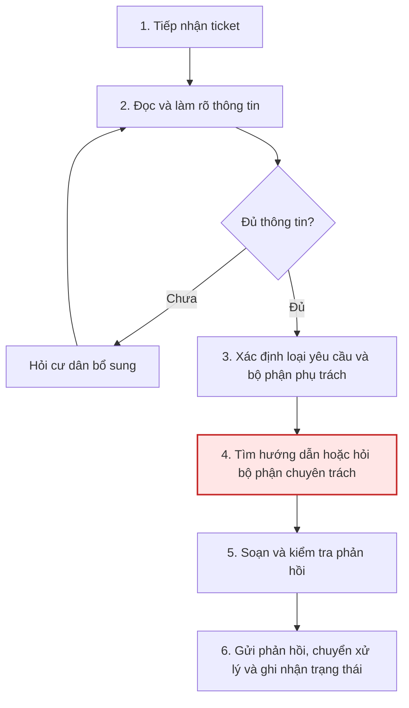
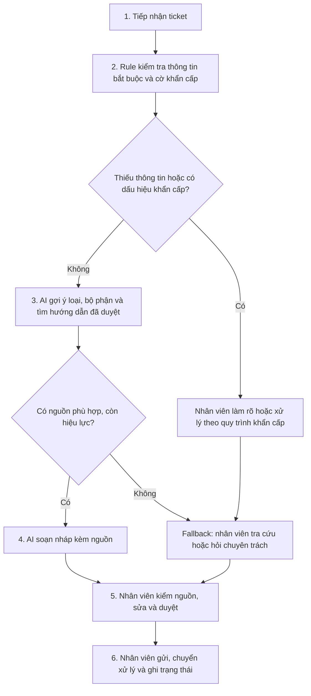

# Báo cáo nhóm — Day 02 Discovery & Problem Framing

> Bản chung của nhóm, viết trên repo do nhóm trưởng fork. Không copy file này sang repo cá nhân.
> Template chi tiết và prompt mẫu: [docs/01-worksheet.md](../../docs/01-worksheet.md). Bài mẫu: [docs/02-deliverable-example.md](../../docs/02-deliverable-example.md).

## 1. Thông tin nhóm

- Tên nhóm: Nhóm AE
- Thành viên: xem `TEAM.md`
- Candidate problem được chọn (1 câu): Xử lý và phản hồi ticket của cư dân
- Quyết định cuối: Go — pilot giới hạn sau khi baseline và quyền sử dụng dữ liệu được xác nhận.

---

## 2. Hội tụ nhóm (CP3)

### 2.1. Pitch

| # | Người đưa ra | Candidate (Job Story ngắn) | Actor | Bottleneck | Câu hỏi phản biện nhận được (ai hỏi) |
|---:|---|---|---|---|---|
| 1 | Mai Lê Bá Vương | Điều hướng vấn đề của cư dân đến bộ phận xử lý | Ban quản lý | Thời gian phản hồi lâu | Làm cách nào để xác nhận đã điều hướng đúng về bộ phận xử lý? (Phạm Hoàng Huy) |
| 2 | Mai Lê Bá Vương | Đối chiếu yêu cầu đặt phòng với tình trạng từng phòng | Ban quản lý | Thời gian và thông tin cần xác nhận | Có cách nào để update tình trạng phòng theo thời gian thực không? (Phạm Hoàng Huy) |
| 3 | Mai Lê Bá Vương | Làm rõ mô tả lỗi xe trước khi đi kiểm tra | Nhân viên sửa xe | Thời gian sửa | |
| 4 | Phạm Hoàng Huy | Tổng hợp file yêu cầu bài tập trước khi làm | Người làm bài tập | Thời gian xác nhận yêu cầu làm bài | |
| 5 | Phạm Hoàng Huy | Sắp xếp deadline môn học | Người làm bài tập | Số lần xác nhận lại deadline | |
| 6 | Phạm Hoàng Huy | Phản hồi ticket vấn đề của cư dân | Ban quản lý | Thời gian phản hồi và xử lý | Độ chính xác của phản hồi? (Cấn Xuân Nghĩa) Nếu hệ thống nghẽn thì xử lý như nào? (Mai Lê Bá Vương) |
| 7 | Cấn Xuân Nghĩa | Người dùng gặp khó khăn trong việc xác minh tính xác thực của thông tin | Người dùng mạng xã hội | Khó khăn khi truy cứu tính xác thực | |
| 8 | Cấn Xuân Nghĩa | Người dùng gặp khó khăn trong việc xác minh nguồn gốc, thời điểm, ngữ cảnh của thông tin được chia sẻ | Người dùng mạng xã hội | Khó khăn khi truy cứu nguồn gốc | Có thật sự cần thiết không? (Phạm Hoàng Huy) |
| 9 | Cấn Xuân Nghĩa | Người dùng gặp khó khăn trong việc kiểm tra video/ hình ảnh có chỉnh sửa của AI | Người dùng mạng xã hội | Khó khăn khi xác thực video/ hình ảnh | Hiện tại do nét chỉnh sửa của AI vẫn khá rõ và tính ứng dụng không cao nên công cụ này có thật sự cần thiết không? (Phạm Hoàng Huy) |

### 2.2. Cluster

| Cluster | Các candidate | Pattern chung |
|---|---|---|
| A — Tiếp nhận và làm rõ yêu cầu | #1 Điều hướng phản ánh cư dân; #3 Làm rõ mô tả lỗi xe; #6 Phản hồi ticket cư dân | Phải đọc, hiểu vấn đề người dùng mô tả và xác định thông tin hoặc bên xử lý phù hợp |
| B — Tổng hợp và đối chiếu thông tin | #2 Đối chiếu yêu cầu đặt phòng; #4 Tổng hợp yêu cầu bài tập; #5 Theo dõi deadline môn học | Thông tin nằm ở nhiều nơi, cần tổng hợp và đối chiếu để biết việc nào khả thi hoặc cần làm |
| C — Kiểm chứng độ tin cậy của thông tin | #7 Xác minh tính xác thực; #8 Kiểm tra nguồn gốc, thời điểm, ngữ cảnh; #9 Kiểm tra ảnh/video có chỉnh sửa bằng AI | Người dùng thiếu căn cứ để đánh giá thông tin có đáng tin và đúng ngữ cảnh hay không |

### 2.3. Opportunity Solution Tree rút gọn

Gốc là **1 outcome**. Nhánh là **opportunity** (nhu cầu, pain), không phải tính năng hay công cụ.

```text
OUTCOME: Giảm thời gian phản hồi ticket cư dân, đồng thời bảo đảm thông tin chính xác và yêu cầu được chuyển đúng bộ phận.
├── Opportunity A: Thông tin phản ánh thiếu vị trí, thời điểm hoặc mô tả
├── Opportunity B: Nhân viên khó tìm hướng dẫn thống nhất, mỗi người một cách hướng dẫn riêng
└── Opportunity C: Trách nhiệm giữa các bộ phận chưa rõ với một số yêu cầu
```

Những ý đã gạch bỏ vì là solution đội lốt opportunity:

-

### 2.4. Chấm điểm shortlist (1–5)

| Candidate | Actor rõ | Quy trình rõ | Pain có bằng chứng | Impact đo được | Vừa sức lab | So sánh được No AI/Rule/Workflow/Agent | Nhóm hiểu domain | Tổng |
|---|---:|---:|---:|---:|---:|---:|---:|---:|
| Mô tả lỗi xe trước khi kiểm tra | 4 | 4 | 3 | 3 | 4 | 4 | 5 | 22 |
| Phản hồi ticket cư dân  | 5 | 5 | 4 | 4 | 5 | 4 | 5 | 32 |
| Kiểm tra tính xác thực của thông tin | 2 | 2 | 3 | 3 | 2 | 3 | 3 | 18 |

**Candidate được chọn:** Phản hồi ticket cư dân

**Vì sao chọn:** Vừa sức đối với nhóm và có thể ứng dụng được

**Vì sao loại các candidate còn lại:** Chưa thật sự nắm rõ domain của candidate, khó triển khai và so sánh thực tế

**Xử lý bất đồng (nếu có):**

---

## 3. Kiểm chứng + research giải pháp đã có (CP4)

### 3.1. Assumption Map

| # | Giả định | Loại (Value / Usability / Feasibility / Viability) | Quan trọng (1–5) | Đã có bằng chứng (1–5) | Kiểm chứng trước? |
|---:|---|---|---:|---:|---|
| 1 | Nhân viên thường nhận những ticket có nội dung tương tự nhau | Value | 5 | 3 | Số lần xuất hiện yêu cầu sửa chữa về chỗ gửi xe tăng cao |
| 2 | Tìm hướng dẫn và soạn lại câu trả lời là bước tốn thời gian đáng kể | Value | 4 | 4 | Nhân viên không thống nhất trong cách xử lý |
| 3 | Hướng dẫn đã duyệt tồn tại nhưng khó tìm hoặc khó biết bản nào mới nhất | Feasibility | 3 | 3 | Cách lưu tài liệu, tìm kiếm và cập nhật hiện tại |
| 4 | Quy định cho phép xử lý nội dung ticket bằng công cụ dự kiến | Viability | 5 | 1 | Quy định dữ liệu và người có thẩm quyền xác nhận|

*Điền 4–6 giả định; xóa dòng thừa.*

Giả định nhóm kiểm chứng trong buổi này: Nhóm tập trung kiểm chứng giả định #1 và #2: nhân viên thường nhận các ticket tương tự nhau, và việc tìm hướng dẫn để chuẩn bị phản hồi chiếm thời gian đáng kể. Nhóm hỏi về các yêu cầu lặp lại gần đây, cách xử lý hiện tại và thời gian tra cứu

### 3.2. Kiểm chứng

Cách đã dùng: Phỏng vấn / Survey / Log, ticket, review

Interview snapshot (mỗi buổi phỏng vấn một bảng, hoặc đặt file trong `report/assets/cp4-interview-snapshot-N.md`):

| Trường | Nội dung |
|---|---|
| Người được hỏi (vai trò, không ghi tên thật) | |
| Câu nói đáng nhớ nhất (nguyên văn) | |
| Lần gần nhất gặp vấn đề này: chuyện gì đã xảy ra? | |
| Hiện đang xử lý bằng cách nào (workaround)? | |
| Mất bao lâu, bao lần? | |
| Insight / opportunity rút ra | |

Tổng hợp:

| Nguồn | Số người / số mẫu | Tín hiệu xác nhận | Tín hiệu phản bác |
|---|---:|---|---|
| Phỏng vấn | 2 | Số lượng ticket trùng nhiều, phản hồi lâu | Không có |

**Nhóm đã sửa problem thế nào sau kiểm chứng:**  Nhóm thu hẹp bài toán từ “phản hồi ticket cư dân” sang “giảm thời gian xử lý các ticket có nội dung lặp lại”. Ba cuộc phỏng vấn ghi nhận nhiều ticket tương tự và thời gian phản hồi lâu.

### 3.3. Research giải pháp đã có

| Công cụ / case / pattern | Link | Giải bước nào trong quy trình? | Điểm mạnh | Khoảng trống / rủi ro | Bài học cho nhóm |
|---|---|---|---|---|---|
| Copilot | https://copilot.com/vi-vn/ | Tìm thông tin và gợi ý câu trả lời từ các nguồn kiến thức được bật. | Hiển thị nguồn để nhân viên kiểm tra; có thể chỉnh sửa trước khi gửi và lưu câu trả lời thành macro. | Cần kiểm tra nguồn có cập nhật, phù hợp quy định từng khu dân cư và được phép sử dụng không. | Gợi ý phản hồi cần có nguồn và người duyệt, thay vì để AI tự trả lời theo kiến thức chung |
| | | | | | |

---

## 4. Quy trình trước/sau (CP5)

**Phạm vi:** Tiếp nhận và chuẩn bị phản hồi đầu tiên cho ticket cư dân có nội dung lặp lại. Việc sửa chữa, xử lý thực địa và đóng ticket thuộc trách nhiệm của nhân viên/bộ phận chuyên trách.

**Cơ sở mô tả:** Các [snapshot #1](../assets/cp4-interview-snapshot-1.md), [#2](../assets/cp4-interview-snapshot-2.md) và [#3](../assets/cp4-interview-snapshot-3.md) ghi nhận yêu cầu lặp lại, chờ phản hồi và khó tìm hướng dẫn. Quy trình dưới đây là bản tổng hợp cần được người vận hành xác nhận; chưa có đo thời gian từng bước.

### 4.1. Quy trình hiện tại



| Bước | Actor | Input | Output | Thời gian / tần suất | Handoff / lưu ý |
|---:|---|---|---|---|---|
| 1. Tiếp nhận | Nhân viên CSKH/ban quản lý | Tin nhắn hoặc ticket cư dân | Yêu cầu được ghi nhận | Chưa đo | Cư dân → nhân viên tiếp nhận |
| 2. Làm rõ | Nhân viên và cư dân | Nội dung phản ánh, vị trí, thông tin liên quan | Yêu cầu đủ thông tin để phân loại | Chưa đo | Hỏi lại nếu thiếu mô tả hoặc vị trí |
| 3. Phân loại | Nhân viên tiếp nhận | Yêu cầu đã làm rõ, danh mục trách nhiệm | Loại yêu cầu và bộ phận dự kiến xử lý | Chưa đo | Xác nhận trách nhiệm khi ticket liên quan nhiều bộ phận |
| 4. Tra cứu và xác nhận | Nhân viên tiếp nhận, bộ phận chuyên trách | Yêu cầu, tài liệu chung, dữ liệu vận hành | Hướng dẫn hoặc thông tin đã xác nhận | Một trường hợp tra cứu được kể mất 30 phút ở snapshot #3; chưa có mức điển hình | Chuyển câu hỏi tới người phụ trách nếu tài liệu không đủ |
| 5. Soạn và kiểm tra | Nhân viên tiếp nhận | Hướng dẫn, kết quả xác nhận | Phản hồi sẵn sàng gửi | Chưa đo | Kiểm tra nội dung, phạm vi áp dụng và thông tin cần bảo mật |
| 6. Phản hồi và bàn giao | Nhân viên tiếp nhận | Phản hồi đã kiểm tra, bộ phận phụ trách | Cư dân nhận phản hồi; yêu cầu được chuyển và ghi trạng thái | Chưa đo | Nhân viên tiếp nhận → cư dân và bộ phận chuyên trách |

**Bottleneck cần kiểm chứng:** Bước 4 — tìm đúng hướng dẫn và xác nhận cách xử lý. Nhân viên ở snapshot #3 cho biết phải tìm trong kho thông tin chung và mất 30 phút ở một trường hợp. Cần đo riêng thời gian tra cứu và thời gian chờ bộ phận khác để xác định phần có thể cải thiện.

**Tổng thời gian hiện tại:** Chưa có baseline. Mốc 10 phút trong snapshot #1 là lời kể về kiểm tra/điều phối chỗ để xe; 30 phút trong snapshot #3 liên quan tra cứu; một ngày trong snapshot #2 là thời gian chờ do cư dân kể. Không cộng hoặc lấy trung bình các mốc khác loại này.

### 4.2. Quy trình tương lai

Đề xuất quy trình có các bước cố định, Rule kiểm tra dữ liệu, AI hỗ trợ tra cứu/soạn nháp và nhân viên duyệt trước mọi hành động. Đây là phương án thử nghiệm; cần so sánh với kho hướng dẫn và mẫu phản hồi không dùng AI.



| Bước | Rule / AI / con người | Kết quả đầu ra | Kiểm soát |
|---:|---|---|---|
| 1 | Con người | Ticket được ghi nhận | Chỉ thu thập dữ liệu cần thiết |
| 2 | Rule; nhân viên xử lý ngoại lệ | Thông tin thiếu và dấu hiệu khẩn cấp được gắn cờ | Tiêu chí do đơn vị phê duyệt; nhân viên kiểm tra thêm, không coi Rule phát hiện được mọi nguy cơ |
| 3 | AI hỗ trợ | Gợi ý loại/bộ phận, hướng dẫn và phiên bản nguồn | Chỉ dùng danh mục, tài liệu được phép; trường hợp không rõ chuyển người |
| 4 | AI hỗ trợ | Bản nháp trả lời có nguồn đối chiếu | Không bịa dữ kiện, chính sách hoặc cam kết xử lý |
| 5 | Con người | Nội dung và bộ phận nhận được xác nhận | Đối chiếu ticket gốc, nguồn, mức khẩn cấp; sửa hoặc bỏ gợi ý |
| 6 | Con người | Phản hồi được gửi, ticket chuyển xử lý và lưu lịch sử | AI không tự gửi, chuyển hoặc đóng ticket |

**Boundary — ranh giới vận hành:**

- AI được gợi ý loại yêu cầu, bộ phận và nội dung nháp từ hướng dẫn đã duyệt; nhân viên quyết định cuối cùng.
- Không tự gửi/chuyển/đóng ticket, thực hiện sửa chữa, hứa thời hạn, bồi thường hoặc miễn phí.
- Không suy diễn thông tin hiện thời như số chỗ đỗ trống hay tiến độ sửa chữa từ tài liệu hoặc ticket cũ; cần xác nhận từ người/hệ thống có trách nhiệm.
- Chỉ dùng tài liệu còn hiệu lực, đúng tòa nhà/phạm vi áp dụng. Dữ liệu thử nghiệm phải được cho phép và khử định danh.
- Ticket thiếu dữ liệu, nguồn mâu thuẫn, ngoài phạm vi hoặc có dấu hiệu khẩn cấp phải được người phụ trách xem xét; không chờ AI soạn xong mới xử lý tình huống khẩn cấp.

**Fallback — phương án quay về:**

| Tình huống | Cách xử lý |
|---|---|
| Không có hướng dẫn phù hợp, không rõ phiên bản hoặc nguồn mâu thuẫn | Nhân viên tra cứu thủ công/hỏi chuyên trách trước khi phản hồi |
| Thiếu thông tin hoặc cần dữ liệu hiện thời | Nhân viên hỏi cư dân hoặc kiểm tra với bộ phận phụ trách |
| AI lỗi, phản hồi sai hoặc nguồn không hỗ trợ nội dung | Bỏ bản nháp; dùng mẫu đã duyệt và quy trình thủ công |
| Có dấu hiệu khẩn cấp | Nhân viên chuyển người phụ trách theo quy trình khẩn cấp hiện hành |

### 4.3. Before / after

| Chỉ số | Trước | Sau (kỳ vọng) | Cách kiểm tra |
|---|---|---|---|
| Số bước chính | 6 bước | 6 bước | Đếm trên luồng thông thường; đo ngoại lệ riêng |
| Tổng thời gian đến phản hồi đầu tiên | Chưa đo | Mục tiêu giảm ít nhất 20% trung vị so với baseline sẽ thu thập | Timestamp từ nhận ticket đến gửi phản hồi; gồm thời gian chờ và duyệt |
| Số bước có công cụ hỗ trợ | Chưa xác nhận công cụ đang dùng | Bước 2 có Rule; bước 3–4 có AI hỗ trợ | Quan sát thao tác và ghi thời gian người thực hiện; không suy ra giờ công chỉ từ số bước |
| Bước con người chịu trách nhiệm | Nhân viên xử lý các bước sau tiếp nhận | Nhân viên kiểm ngoại lệ, duyệt và gửi/chuyển; vẫn giám sát toàn bộ quy trình | Kiểm lịch sử thao tác và quyết định |
| Bottleneck | Giả thuyết: tìm hướng dẫn và chờ xác nhận | Kỳ vọng giảm tra cứu/soạn lại; chờ chuyên trách có thể vẫn tồn tại | Tách thời gian tra cứu, soạn, duyệt và chờ |
| Rủi ro mới | Chưa đánh giá đầy đủ | AI chọn sai nguồn, phân loại sai, soạn sai hoặc lộ dữ liệu | Đối chiếu từng gợi ý với ticket, tài liệu và nhãn nhân viên xác nhận |

**Kế hoạch đo:** Trước thử nghiệm, ghi các mốc nhận ticket, đủ thông tin, bắt đầu/kết thúc tra cứu, soạn, duyệt và gửi phản hồi. So sánh quy trình hiện tại, mẫu phản hồi/Rule và phương án AI trên bộ tình huống tương đương. Ghi riêng thời gian hoàn tất sửa chữa; không dùng thời gian tạo nháp để thay cho thời gian phản hồi hoặc giải quyết sự cố.

---

## 5. Problem Statement v0 (CP5)

| Trường | Nội dung |
|---|---|
| **Actor** | Nhân viên tiếp nhận/CSKH tại ban quản lý, phụ trách phản hồi và phối hợp xử lý yêu cầu cư dân. |
| **Quy trình** | Tiếp nhận → làm rõ → phân loại → tra cứu/xác nhận → soạn và kiểm tra → phản hồi, chuyển xử lý và ghi nhận trạng thái. Bản tổng hợp cần người vận hành xác nhận. |
| **Bottleneck** | Tìm đúng hướng dẫn và xác nhận cách xử lý cho yêu cầu lặp lại. Snapshot #3 ghi một trường hợp tra cứu mất 30 phút; chưa xác lập mức điển hình và chưa tách thời gian chờ. |
| **Impact** | Nhân viên phải tra cứu lại, cư dân có thể chờ phản hồi. Ba snapshot cho thấy yêu cầu lặp lại, khó tìm thông tin và chờ đợi; chưa đủ dữ liệu để định lượng tổng giờ công, chi phí hoặc mức phổ biến. |
| **Success Metric** | **Baseline:** chưa đo thời gian đến phản hồi đầu tiên, độ đúng nội dung và tỷ lệ chuyển lại. **Target đề xuất:** giảm ít nhất 20% thời gian phản hồi trung vị; tỷ lệ phản hồi đúng hướng dẫn và tỷ lệ phân tuyến đúng đều ≥90%; mọi ca khẩn cấp trong bộ kiểm thử được đưa cho người xử lý, không có phản hồi tự gửi. **Cách đo:** timestamp, quan sát và nhân viên đối chiếu nội dung/tuyến xử lý với tài liệu đã duyệt; đo riêng từng chỉ số và thời gian tra cứu, soạn, duyệt, chờ. Mục tiêu chỉ được xác nhận sau khi thu thập baseline, chưa phải kết quả đã đạt. |
| **Boundary** | AI chỉ hỗ trợ gợi ý và soạn nháp có nguồn. Nhân viên kiểm tra trước khi gửi/chuyển; AI không tự đóng ticket, cam kết thời hạn, bịa thông tin vận hành hay thực hiện hành động kỹ thuật. Thiếu thông tin, nguồn mâu thuẫn, ngoài phạm vi, khẩn cấp hoặc công cụ lỗi thì chuyển người và quay về quy trình thủ công. |

### 5.1. Phản biện bản v0 và hướng xử lý

Các điểm dưới đây được ghi nhận qua rà soát bằng AI; nhóm cần tự xem xét và chốt, chưa ghi nhận sự đồng thuận hoặc kết quả kiểm chứng mới.

| Điểm phản biện | Hướng xử lý trong bản v0 | Điều cần kiểm chứng tiếp |
|---|---|---|
| Phản hồi chậm chưa chắc do khó tìm hướng dẫn | Tách thời gian tra cứu, soạn, duyệt và chờ bộ phận khác | Quan sát từng bước trên ticket thực tế |
| Một trường hợp 30 phút chưa phải baseline | Giữ là bằng chứng định tính có mốc thời gian, không suy rộng | Đo nhiều trường hợp cùng loại và tính trung vị |
| Kho hướng dẫn hoặc mẫu trả lời có thể đã đủ | Đưa No AI/Rule vào phương án so sánh | Kiểm tra độ bao phủ, thời gian và chất lượng khi dùng mẫu |
| Nhanh hơn nhưng trả lời sai vẫn không đạt | Đo đồng thời thời gian, nội dung đúng, phân tuyến đúng và xử lý ca khẩn cấp | Nhân viên có trách nhiệm xác nhận nhãn và tiêu chí đánh giá |

---

## 6. Mức can thiệp AI (CP6)

### 6.1. Ma trận độ mơ hồ × độ phức tạp

Bài của nhóm nằm ở ô **độ mơ hồ cao, độ phức tạp thấp–trung bình**. Nội dung ticket cư dân thường là văn bản tự do nên có nhiều cách diễn đạt cho cùng một sự cố; còn quy trình tiếp nhận, phân loại, chuyển bộ phận và phản hồi có thể thiết kế thành các bước cố định.

Các snapshot CP4 cho thấy ticket lặp lại, nhân viên phải tìm hướng dẫn và cư dân có lúc phải chờ phản hồi. Nhóm chưa có baseline định lượng thống nhất, nên pilot sẽ đo thời gian phản hồi và chất lượng nguồn trước khi so sánh.

Vì vậy, mức phù hợp để thử là Workflow có các bước cố định, trong đó AI tìm hướng dẫn đã duyệt và soạn nháp phản hồi có dẫn nguồn; nhân viên xác nhận trước khi gửi.

### 6.2. So sánh 4 mức

| Mức | Phương án cho bài của nhóm | Đủ khi nào | Rủi ro | Chọn? |
|---|---|---|---|---|
| **No AI** (sửa quy trình) | Chuẩn hóa form gửi ticket, danh mục sự cố, thông tin vị trí bắt buộc và mẫu phản hồi | Nội dung có cấu trúc, nhóm sự cố ít và quy tắc chuyển tuyến rõ | Người gửi vẫn chọn sai danh mục hoặc nội dung tự do cần người đọc | Nên làm nền tảng; có thể đủ nếu form giảm được lỗi phân loại |
| **Rule** | Dựa vào danh mục, vị trí và từ khóa để gán bộ phận/loại ticket | Trường đầu vào rõ, quy tắc ổn định, ít ngoại lệ | Không hiểu tốt cách diễn đạt đa dạng; từ khóa dễ gây chuyển sai | Dùng cho trường dữ liệu xác định được, cần đo tỷ lệ đúng |
| **Workflow** | Nhận ticket → Rule kiểm tra thông tin → AI tìm hướng dẫn đã duyệt và soạn draft có nguồn → nhân viên duyệt/chỉnh → gửi và chuyển xử lý | Ticket lặp lại cần tra cứu; quy trình tra nguồn và duyệt có thể định trước | Chọn sai/nguồn cũ hoặc draft không bám hướng dẫn | **Chọn để pilot giới hạn**, chỉ với tài liệu được duyệt và người duyệt |
| **Agent** | AI tự đọc ticket, hỏi cư dân, quyết định bộ phận và phản hồi/đóng ticket | Chỉ khi cần tự xử lý nhiều nhánh không định trước và có kiểm soát đáng tin cậy | Có thể hỏi sai, chuyển sai, hứa sai hoặc tự đóng ticket | Chưa chọn; quyền tự hành động chưa có bằng chứng cần thiết |

**Mức chọn:** Workflow cho pilot giới hạn; chưa triển khai rộng.

**Vì sao không chọn mức đơn giản hơn:** Form chuẩn hóa và Rule phù hợp để kiểm tra trường bắt buộc, loại ticket và tuyến chuyển. Chúng không tự tìm đoạn hướng dẫn phù hợp trong kho tài liệu hay soạn câu trả lời theo ngữ cảnh. Workflow chỉ thêm AI ở hai bước đó, còn các bước còn lại vẫn theo quy tắc và do nhân viên kiểm soát. Nếu pilot cho thấy tìm kiếm và mẫu trả lời thường đã đủ nhanh, nhóm sẽ quay về No AI/Rule.

### 6.3. AI Canvas rút gọn

| Thành phần | Nội dung |
|---|---|
| **Prediction** — AI dự đoán / tạo ra gì? | Tìm đoạn hướng dẫn đã duyệt phù hợp với ticket lặp lại và soạn nháp phản hồi dựa trên nguồn đó. Không tự suy ra chính sách hay tình trạng vận hành hiện thời. |
| **Judgment** — con người cân nhắc, quyết định gì? | Nhân viên kiểm tra ticket, tòa nhà/phạm vi áp dụng và phiên bản hướng dẫn; xác nhận nội dung và tuyến xử lý, hoặc bỏ nháp nếu nguồn không phù hợp. |
| **Action** — hành động cuối cùng là gì, ai làm? | Nhân viên xác nhận rồi mới gửi phản hồi và chuyển ticket. |
| **Outcome** — đo kết quả bằng gì? | Thời gian tra cứu và đến phản hồi đầu tiên, tỷ lệ câu trả lời bám đúng hướng dẫn còn hiệu lực, tỷ lệ nhân viên chấp nhận draft sau chỉnh sửa, và số ticket phải hỏi lại/chuyển lại. |
| **Input** — AI cần dữ liệu đầu vào gì mỗi lần chạy? Có sẵn không? | Ticket đã khử định danh, tòa nhà/phạm vi, kho hướng dẫn đã duyệt có phiên bản, danh mục ticket và mẫu phản hồi. Quyền truy cập cần được xác nhận trước pilot. |
| **Feedback** — lấy phản hồi ở đâu để cải thiện? | Nhân viên đánh dấu nguồn đúng/sai, lý do sửa hoặc từ chối draft, ticket phải hỏi lại/chuyển lại; lưu theo quy định dữ liệu của đơn vị. |

### 6.4. Hai câu hỏi của Google PAIR

- Người dùng muốn **được hỗ trợ (augment)** hay **giao hẳn việc (automate)**? Bằng chứng: Các snapshot CP4 ghi nhận nhân viên tra cứu thủ công, có trường hợp mất 30 phút tìm hướng dẫn; cư dân kể đã chờ phản hồi lâu. Snapshot chưa hỏi trực tiếp người dùng muốn được hỗ trợ hay giao hẳn việc. Vì vậy pilot đề xuất augment với nhân viên duyệt, rồi cần xác nhận lựa chọn này với nhân viên vận hành.
- AI sai kiểu nào tệ hơn, **báo nhầm** hay **bỏ sót**? Vì sao, và thiết kế đã xử lý thế nào: Với bài toán này, trích sai hoặc dùng hướng dẫn hết hiệu lực có thể dẫn đến phản hồi sai; bỏ sót hướng dẫn phù hợp khiến nhân viên tiếp tục tra cứu thủ công. Workflow chỉ dùng nguồn đã duyệt và hiện phiên bản; nếu không tìm được nguồn phù hợp thì chuyển nhân viên tra cứu, không để AI tự trả lời.

---

## 7. Problem Statement v1 + tiêu chí đánh giá (CP6)

| Trường | Nội dung |
|---|---|
| **Actor** | Nhân viên tiếp nhận/CSKH tại ban quản lý, phụ trách tìm hướng dẫn và chuẩn bị phản hồi cho ticket cư dân lặp lại. |
| **Quy trình** | Nhận ticket → làm rõ → phân loại → tra cứu hướng dẫn → soạn và kiểm tra → phản hồi, chuyển xử lý và ghi trạng thái. |
| **Bottleneck** | Tra cứu hướng dẫn đã duyệt và xác nhận phiên bản phù hợp; snapshot #3 ghi một trường hợp mất 30 phút, chưa phải baseline đại diện. |
| **Impact** | Tra cứu lặp lại có thể làm chậm phản hồi và tạo cách hướng dẫn không thống nhất; CP4 có ví dụ cụ thể nhưng chưa đủ dữ liệu để khái quát quy mô. |
| **Success Metric** (baseline → target, cách đo) | **Baseline:** đo trong tuần trước pilot, bằng thời gian từ lúc nhận ticket lặp lại đến phản hồi đầu tiên, tỷ lệ draft bám hướng dẫn còn hiệu lực và tỷ lệ hỏi lại/chuyển lại. **Target:** giảm ít nhất 20% thời gian phản hồi trung vị; ít nhất 95% draft dẫn đúng hướng dẫn còn hiệu lực; không tăng tỷ lệ hỏi lại/chuyển lại. **Cách đo:** so sánh timestamp và nhân viên đối chiếu draft với kho hướng dẫn trên tối đa 50 ticket tương đương. |
| **Boundary** | AI chỉ tìm hướng dẫn được duyệt và soạn nháp kèm nguồn; không tự gửi/chuyển/đóng ticket, hứa thời hạn, đưa thông tin vận hành hiện thời hoặc xử lý ngoại lệ khẩn cấp. Nhân viên xác minh nguồn, phạm vi và nội dung trước mọi hành động. |
| **AI intervention point** | Sau khi ticket đủ thông tin và đã phân loại, tại bước tìm hướng dẫn và chuẩn bị phản hồi. |
| **Mức chọn** | Workflow cho pilot giới hạn; so sánh với tra cứu thủ công/mẫu trả lời và Rule. |
| **Rủi ro & người kiểm tra** | Rủi ro dùng sai hoặc cũ hướng dẫn; nhân viên trực kiểm tra nguồn, phiên bản và draft trước khi gửi. Chỉ chạy khi được phép dùng dữ liệu và tài liệu. |

**Thay đổi so với v0 và lý do:**

| Trường | v0 | v1 | Vì sao đổi |
|---|---|---|---|
| Success Metric | CP5 nêu baseline chưa đo; đề xuất giảm 20% thời gian phản hồi và độ đúng nội dung/tuyến xử lý ≥90% | Đo baseline trước pilot; đặt mục tiêu giảm 20% thời gian phản hồi và ≥95% draft dẫn đúng nguồn hiện hành | Chuyển cách đo từ đề xuất chung sang chỉ số pilot; baseline phải thu thập trước khi đánh giá |
| Boundary | AI soạn nháp có nguồn, nhân viên kiểm trước khi gửi | AI chỉ tra hướng dẫn được duyệt và soạn draft; nhân viên xác minh nguồn/phạm vi; không tự gửi hay xử lý khẩn cấp | Thu hẹp hành động AI vào tra cứu và soạn nháp |
| AI intervention point | CP5 xác định bottleneck tra hướng dẫn và xác nhận cách xử lý | Sau khi ticket đủ thông tin, tại bước tìm hướng dẫn và chuẩn bị phản hồi | Gắn can thiệp với bottleneck nhóm đã nêu ở CP5 |

**Tiêu chí đánh giá đầu ra của AI (3–5 tiêu chí):**

| # | Tiêu chí | Đạt khi | Không đạt khi |
|---:|---|---|---|
| 1 | Đúng nguồn và đúng phiên bản | Mọi chỉ dẫn trong draft truy được đến tài liệu được duyệt, còn hiệu lực và đúng phạm vi | Dùng nguồn không rõ, hết hạn hoặc áp dụng cho tòa nhà khác |
| 2 | Bám sát nguồn | Mọi hướng dẫn trong draft được hỗ trợ trực tiếp bởi nguồn đã dẫn | Thêm chính sách, thời hạn hoặc thông tin không có trong nguồn |
| 3 | Đủ ý và phù hợp ticket | Draft trả lời đúng câu hỏi và không bỏ qua điều kiện quan trọng trong ticket | Bỏ sót câu hỏi hoặc áp dụng hướng dẫn không liên quan |
| 4 | Chuyển người khi không chắc | Không có nguồn phù hợp thì báo không tìm thấy và yêu cầu nhân viên tra cứu | Tự tạo câu trả lời khi nguồn thiếu/mâu thuẫn |

---

## 8. Quyết định (CP6)

### 8.1. Bốn rủi ro

| Rủi ro | Câu hỏi | Mức độ rủi ro (Thấp = an toàn / TB / Cao = nguy hiểm) | Lý do / bằng chứng |
|---|---|---|---|
| **Value** | Người dùng có thật sự cần và sẽ dùng không? | Trung bình | Hai snapshot nhân viên ghi nhận ticket lặp lại và khó tìm hướng dẫn; snapshot cư dân kể đã chờ phản hồi. Tín hiệu định tính ủng hộ pain nhưng chưa đại diện. |
| **Usability** | Người dùng có dùng được, có hiểu và sửa được đầu ra của AI không? | Thấp | AI chỉ trả nguồn và draft trong quy trình hiện tại; nhân viên kiểm tra và quyết định trước khi gửi. Pilot đo tỷ lệ chấp nhận và thời gian chỉnh sửa. |
| **Feasibility** | Có đủ dữ liệu, công cụ, kỹ năng để làm không? | Trung bình | Snapshot cho thấy nhân viên đang tra cứu kho thông tin chung; cần xác nhận kho hướng dẫn có thể cấp quyền, phiên bản tài liệu rõ và ticket được phép dùng trong pilot. |
| **Viability** | Có hợp chi phí, pháp lý, quy định tổ chức không? Ai vận hành? | Trung bình | Phạm vi pilot nhỏ, không tự động gửi và chỉ dùng tài liệu được duyệt; vẫn cần đơn vị vận hành xác nhận quyền dùng dữ liệu và phân công người quản lý kho hướng dẫn. |

### 8.2. Kết luận

**Quyết định:** Go — pilot giới hạn.

**Lý do:** Snapshot CP4 cung cấp tín hiệu định tính về ticket lặp lại, thời gian chờ và khó tìm hướng dẫn. Nhóm sẽ đo baseline thật trước khi đánh giá hiệu quả. Không rủi ro nào được xếp Cao trong phạm vi pilot giới hạn nếu tài liệu và dữ liệu được phê duyệt, AI chỉ tra cứu/soạn nháp và nhân viên duyệt mọi nội dung. Go chỉ áp dụng cho pilot nhỏ có kiểm soát, chưa phải triển khai rộng.

**Nếu Go — pilot nhỏ nhất:** Sau khi được phép dùng dữ liệu, chạy pilot 2 tuần trên tối đa 50 ticket lặp lại đã khử định danh. AI tìm hướng dẫn có nguồn và soạn nháp; nhân viên xác minh nguồn, sửa và tự gửi/chuyển ticket. Ghi baseline trong tuần trước pilot, rồi theo dõi thời gian đến phản hồi đầu tiên, độ đúng/hiệu lực nguồn, tỷ lệ draft được chấp nhận và số lần hỏi lại/chuyển lại.

**Nếu Not Yet — cần kiểm chứng gì trước:** Nếu chưa có phê duyệt dữ liệu hoặc chưa xác nhận được quy trình/kho hướng dẫn, tạm hoãn pilot và làm rõ baseline cùng quyền sử dụng dữ liệu với bộ phận phụ trách.

**Nếu No-Go — nên làm gì thay AI:** Chuẩn hóa danh mục sự cố, trường bắt buộc về vị trí/mức độ, quy tắc chuyển tuyến và mẫu phản hồi đã duyệt.

**Ngưỡng dừng** (nếu sau … mà … thì quay về …): Dừng pilot nếu dưới 95% draft dẫn đúng hướng dẫn còn hiệu lực trong mẫu tối đa 50 ticket, có một phản hồi chứa thông tin không được nguồn hỗ trợ, thời gian phản hồi trung vị không giảm ít nhất 20% so với baseline tuần trước, hoặc nhân viên phải viết lại trên 30% draft. Khi dừng, quay về kho hướng dẫn/mẫu trả lời và quy trình tra cứu thủ công để xem lại nguồn, tiêu chí và phạm vi.

---

## 9. Hạn chế và hướng tiếp theo

-

## 10. Tài liệu tham khảo

-
